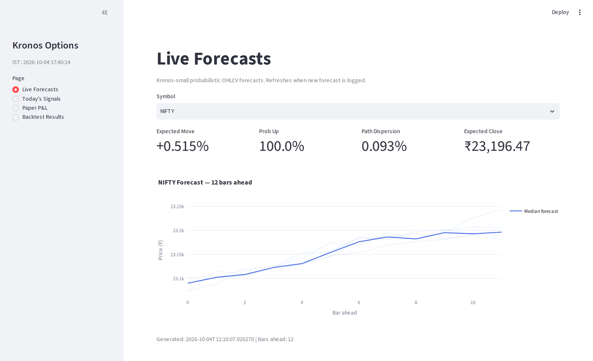
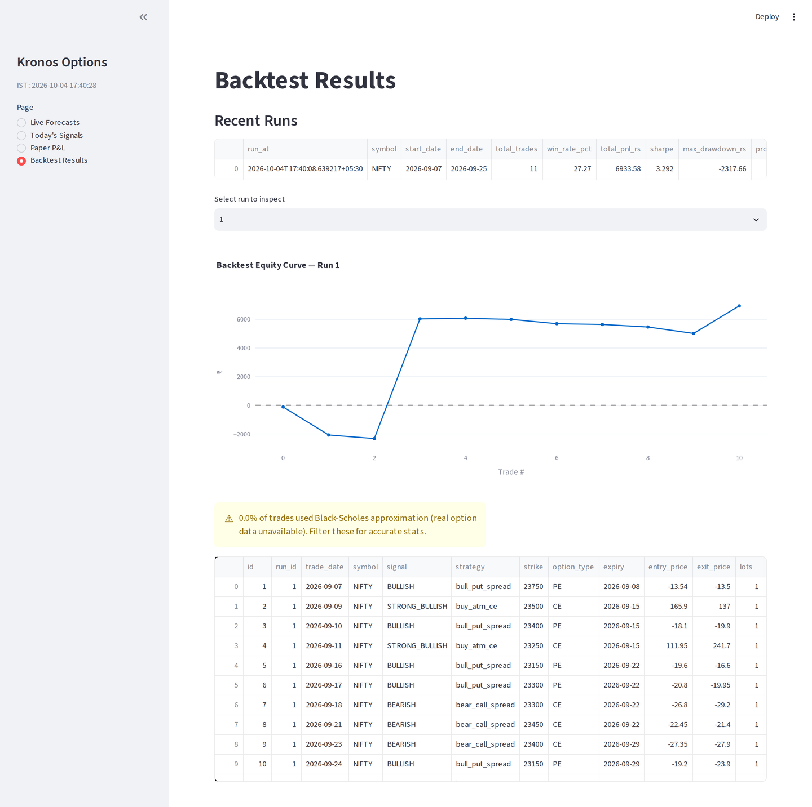
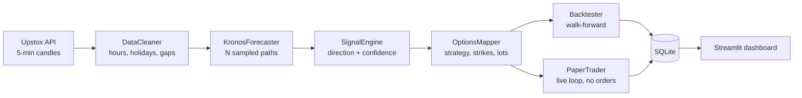

# Kronos Options

**A signal engine for Indian index options: a candlestick foundation model forecasts NIFTY, BANKNIFTY and SENSEX, and those forecasts become concrete option trades priced against real historical option data and real Indian costs.**

[](https://github.com/rajmaurya0904/kronos-options/actions/workflows/tests.yml)
[](LICENSE)

Most retail "signals" are an indicator crossing a line, and most backtests of them are priced with Black-Scholes and no costs, so the numbers are fiction. This asks a different question — *given the last 400 five-minute candles, what is the **distribution** of where the index goes in the next hour?* — and then prices the resulting trade at the real option candle for the real entry and exit minute, minus brokerage, STT, exchange charges, GST, stamp duty and a tick of slippage per leg. It also refuses to trade most of the time: the neutral zone is deliberately wide.

## A real run

NIFTY, 7–25 Sep 2026, 1 lot, a signal every 30 minutes, hard square-off at 15:15, all costs included. Run in GitHub Actions against live Upstox data:

```bash
python run_backtest.py --symbol NIFTY --start 2026-09-07 --end 2026-09-25
```

| Trades | Win rate | Net P&L | Avg win | Avg loss | Profit factor | Max drawdown |
|---|---|---|---|---|---|---|
| 11 | 27.3% (3W / 8L) | ₹+6,934 | ₹+3,438 | ₹−422 | 3.05 | ₹−2,318 |

**Read that as a demo, not as evidence of an edge.** Eleven trades over three weeks is far too few to judge anything. One trade (11 Sep, a long call, ₹+8,347) produced more than the entire net profit; without it the period was ₹−1,413. Over a sample this small the Sharpe ratio is meaningless, so it is left out. Run longer periods yourself before drawing a conclusion.

To reproduce it in CI: **Actions → dashboard screenshots → Run workflow** (needs an `UPSTOX_ACCESS_TOKEN` repo secret). The same workflow captures the dashboard headless:

<p align="center">
  
  <br><em>Live Forecasts: Kronos samples several futures; the bold line is the median path.</em>
</p>

<p align="center">
  
  <br><em>Backtest Results: equity curve and trade log. Every trade here was priced from real option candles.</em>
</p>

## Install

Runs on CPU — no GPU. Kronos-small is 24.7M parameters and fits comfortably in 8 GB of RAM. There is no PyPI package; clone it and install the requirements.

```bash
git clone https://github.com/rajmaurya0904/kronos-options.git
cd kronos-options
pip install -r requirements.txt
```

The model code lives in a separate repo (the weights download from Hugging Face on first run):

```bash
git clone https://github.com/shiyu-coder/Kronos
cd Kronos && pip install -r requirements.txt
```

Then add credentials and initialise the database:

```bash
cp .env.example .env     # Windows: copy .env.example .env
python -c "from src.db import init_db; init_db()"
```

| Variable | What |
|---|---|
| `UPSTOX_ACCESS_TOKEN` | Your Upstox token. It expires daily — refresh it each morning before 09:15. |
| `KRONOS_REPO_PATH` | Full path to the Kronos folder you just cloned. |

## Usage

```bash
# Walk-forward backtest on real option prices
python run_backtest.py --symbol NIFTY --start 2025-05-01 --end 2025-06-09

# Same, two lots
python run_backtest.py --symbol BANKNIFTY --start 2025-06-01 --end 2025-12-31 --lots 2

# Live paper-trading loop during market hours — no orders are ever sent
python -m src.paper_trader --symbols NIFTY BANKNIFTY

# Dashboard: Live Forecasts, Today's Signals, Paper P&L, Backtest Results
streamlit run dashboard/app.py          # http://localhost:8501
```

The backtest prints trades, win rate, P&L, average win and loss, profit factor, Sharpe and max drawdown, and warns you what share of trades fell back to Black-Scholes. Sharpe is computed over every session in the window, including days with no trade, so idle days are not quietly dropped. To keep only the trades priced from real option data:

```python
real = result["trade_log"][result["trade_log"]["data_source"] == "real_option_data"]
```

The paper trader wakes just after each 5-minute bar closes, combines cached history with today's intraday candles, and uses completed bars only. It logs a paper trade only when every leg has a live price, marks open positions to market after costs, and squares off at 15:15.

## How it works



[Kronos](https://github.com/shiyu-coder/Kronos) samples several possible future paths per bar. The signal engine reads that cloud: how many paths end higher, how far they move, how spread out they are. Probability and magnitude must agree before it goes directional — a high up-probability with a tiny expected move stays `NEUTRAL`.

| Signal | `prob_up` | Expected move |
|---|---|---|
| `STRONG_BULLISH` | ≥ 0.75 | ≥ +0.50% |
| `BULLISH` | ≥ 0.65 | ≥ +0.25% |
| `NEUTRAL` | everything else | everything else |
| `BEARISH` | ≤ 0.35 | ≤ −0.25% |
| `STRONG_BEARISH` | ≤ 0.25 | ≤ −0.50% |

Confidence is `0.6 × conviction + 0.4 × magnitude`, where conviction is how far `prob_up` sits from 0.5 and magnitude is the expected move capped at 1%. The spread of the sampled path endpoints sets the **dispersion regime**; live implied volatility sets the **IV regime**. Together they pick the trade:

| Signal | Regime | Default strategy |
|---|---|---|
| `STRONG_BULLISH` | – | Buy ATM CE |
| `BULLISH` | – | Bull put spread |
| `NEUTRAL` | high dispersion, low IV | Long straddle |
| `NEUTRAL` | low dispersion, high IV | Iron condor |
| `BEARISH` | – | Bear call spread |
| `STRONG_BEARISH` | – | Buy ATM PE |

Three further things do most of the work:

- **Real option pricing.** The backtester prices every leg at the real entry minute and the real exit minute from Upstox's expired-instruments 1-minute candles, using each contract's own historical lot size. If any leg has no data the whole trade falls back to Black-Scholes and is tagged `bs_approximation` — a trade is never half real, half modelled.
- **One cost model.** Backtester and paper trader share `src/costs.py`: ₹20 per order, STT 0.15% on sell premium, exchange charge 0.03553% (NSE) / 0.0325% (BSE), 18% GST, SEBI turnover fee, stamp duty on buys, and one tick of slippage each way — per leg, on actual turnover.
- **Risk rules in the loop.** No trades in the first 5 minutes, none after 15:15, a hard 15:15 square-off, expiry days skipped (read from the broker's real expiry list) and event days skipped from a configurable calendar.

Upstox is the primary broker, behind a small interface in `src/broker/`; a Zerodha stub is included but incomplete.

### Configuration

Every threshold and strategy choice lives in [`config.yaml`](config.yaml), so you can tune the engine without touching code.

| Area | Key settings |
|---|---|
| Model | `kronos.lookback: 400` bars in, `pred_len: 12` bars out (1 hour), `samples: 5`, `temperature: 1.0`, `top_p: 0.9` |
| Session | `09:15–15:30` IST, no new trades after `15:15`, `skip_expiry_day: true` |
| Sizing | `paper_trading.capital_per_trade: 50000`, `max_open_positions: 3` |
| Instruments | NIFTY (lot 65, weekly Tue expiry), BANKNIFTY (lot 30, monthly last-Tue expiry), SENSEX (lot 20, weekly Thu expiry) |

Lot sizes and expiry days change over time. The backtester takes lot sizes from each historical contract and expiry days from the broker, so past periods are sized correctly; the `config.yaml` values are what live and paper trading use, so keep them current.

### Project layout

```
config.yaml            all settings, no credentials
run_backtest.py        backtest CLI
dashboard/app.py       Streamlit dashboard (4 pages)
src/broker/            base interface · Upstox (primary) · Zerodha (stub)
src/data_fetcher.py    candles + option candles, cached to CSV
src/data_cleaner.py    market hours, holidays, gaps
src/forecaster.py      Kronos-small wrapper, forecast cache
src/signal_engine.py   forecast → signal
src/options_mapper.py  signal → option legs
src/backtester.py      walk-forward, real option prices
src/paper_trader.py    live loop, no real orders
src/live_trader.py     real orders (locked off by default)
src/db.py              SQLite schema and helpers
src/utils.py           IST helpers, config loader, broker factory
```

## Paper vs real money

**The default mode is paper trading, and in it no orders are ever sent.** Live order placement exists in `src/live_trader.py` but is off by default and takes four separate deliberate actions to enable:

1. `LIVE_TRADING=true` in `.env`
2. the `--live` flag on the command line
3. typing `I CONFIRM LIVE TRADING` at the startup prompt
4. `live_trading.enabled: true` in `config.yaml`

If you do turn it on: orders are intraday (MIS) market orders on resolved option contracts. Hedge legs are bought before short legs are sold, and shorts are bought back first on exit, so a naked short never exists. Every order must reach `complete`; if a leg fails, the filled legs are closed and the kill switch engages. `config.yaml` caps it at 3 trades a day, ₹50,000 per trade, and a −₹5,000 daily-loss kill switch.

This is research and educational software, **not financial advice**. Options trading can lose money quickly. Forecasts are probabilistic and are often wrong, and simulated results do not predict future ones. Paper-trade it for weeks before considering anything else.

## Limitations

- Exits are time-based only. There is no per-trade stop-loss or target.
- Upstox access tokens expire daily, so live and paper runs need a fresh token every morning.
- Upstox's expired-instruments history may not reach far enough back for older backtests, which pushes trades onto the Black-Scholes fallback (15% IV, 6.5% risk-free rate). Filter on `data_source` before trusting a result.
- Paper-trader positions are held in memory. On a mid-day restart, earlier open rows are marked `ABANDONED` rather than left open forever.
- SENSEX index volume is often zero (BSE methodology). It is flagged and not used as a feature.
- The Kronos wrapper follows the model repo's documented API. If upstream changes it, `_run_kronos()` in `src/forecaster.py` needs adjusting.
- The Zerodha broker is a stub; only Upstox is implemented.
- The only published result is the three-week sample above. There is no long walk-forward study yet, so treat the strategy as unvalidated.

## Development

```bash
pip install -r requirements.txt
pytest tests/ -q          # 29 passed in 27.43s
```

Unit tests cover the IST/config utilities, data cleaner, signal engine, expiry detection and cost model, and run on every push via GitHub Actions. Setup notes and good first contributions are in [CONTRIBUTING.md](CONTRIBUTING.md).

Thanks to [Kronos](https://github.com/shiyu-coder/Kronos) by shiyu-coder for the forecasting model, and to [Upstox](https://upstox.com/developer/api-documentation/) for market and option data.

Released under the [MIT License](LICENSE).
